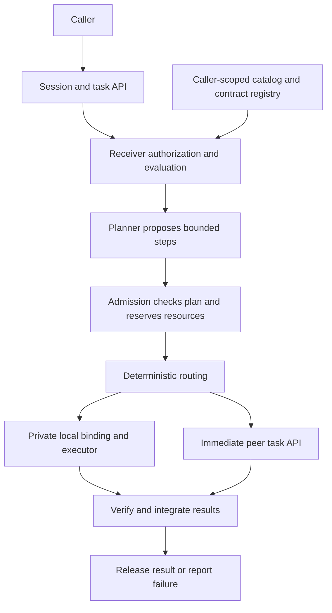

# Requirements and architectural decisions

## Required outcomes

LASA accepts asynchronous work in durable sessions, each bound to a service-owned workspace. It can fulfill work locally and optionally through one configured immediate peer. It discovers the peer's contracts and request format, admits only authorized and feasible work, exposes useful diagnostic evidence, and reports completion or failure honestly. Each peer can repeat this pattern with its own immediate peer.

The caller needs a stable request contract and accountable result. It does not need the peer's model provider, tool inventory, prompts, workspace layout, or internal delegation topology. A service may offer an outcome it fulfills through its peer. Consequently, published capabilities describe externally observable behavior, not locally installed tools.

We assume configured administrative trust between immediate peers. TLS and workload credentials authenticate a peer; receiver policy still decides what it may do. This core design does not prove correctness against a malicious authorized service or implement a universal cross-organization authorization federation. Those assurances would need a separately specified trust profile; they must not be advertised by implication.

## Ownership

| Component | Owns | Must not own |
|---|---|---|
| Contract registry | Immutable definitions and trusted publisher bindings | Live capacity or execution permission |
| Offer publisher | Caller-scoped offers and revisions | Task admission guarantees |
| Authorization resolver | Receiver-owned task authority snapshot | Planning or model judgments |
| Planner | Proposed requirements, bounded steps, semantic suitability | Permission, budget increases, final admission |
| Admission controller | Verified plan, reservations, accepted/rejected decision | Inventing capability claims |
| Router | Deterministic executor choice from verified facts and policy | Model-supplied authority |
| Executor/tool broker | Fulfillment inside approved resources and effects | Unapproved network access or new tools |
| Delegation controller | Disclosure, child identity, budget reservation, reconciliation | Transfer of parent accountability |
| Result verifier | Schema, provenance, acceptance evidence, release decision | Treating a valid schema as proof of truth |
| Durable task store | State, idempotency, resource ledger, audit metadata | Automatic replay after a crash |

Codex App Server remains a possible local executor behind this boundary. The public protocol does not depend on Codex thread IDs, provider model names, or MCP tool names. Model access and external tools remain mediated by LASA policy. A model can recommend delegation; only the controller can authorize and dispatch it.

## Decisions and alternatives

1. **Outcome contracts, not broad skill labels.** Names such as `coding` cannot specify admissible inputs, required access, allowed effects, or completion evidence. A contract defines those semantics. Natural-language descriptions assist planning but are never permission grants.
2. **Separate definition, offer, availability, and authority.** A single `capabilities` object mixing these concepts makes caching unsafe and makes a claim look like permission. Separate resources have separate owners and lifetimes.
3. **Configured descriptor first; registered API catalog for optional bootstrap.** A peer configuration already identifies where to connect. Discovery should not require an origin-root route or a new well-known registration. See [discovery](discovery.md).
4. **One explicit LASA HTTP protocol.** OpenAPI describes transport; JSON Schema describes payloads; capability definitions describe outcome semantics. Neither schema alone captures execution obligations. There is no alternate legacy route or compatibility shim in this target.
5. **Do not label the API A2A-compatible.** A2A is a relevant existing agent protocol, with Agent Cards, skills, tasks, and discovery. Its card's protocol features are not LASA's outcome contracts. Adopting A2A would require specifying how its task semantics enforce LASA admission, resource ceilings, release, and receiver authority. This design needs those explicit contracts first and does not add a speculative adapter. A future decision to use A2A should replace the transport contract, not silently run two authorities. [A2A specification](https://a2a-protocol.org/latest/specification/)
6. **MCP describes private tool integration.** MCP tool schemas are useful behind the service boundary, but they do not establish public outcome guarantees, caller permission, or delegation admission. Tool names and model settings stay private. [MCP tools](https://modelcontextprotocol.io/specification/2025-11-25/server/tools)
7. **Exact contract selection.** An incompatible semantic change gets a new major capability version; every published revision is immutable. Admission pins an exact version and digest. No inferred substitution based on similarly shaped JSON.
8. **Receiver-owned authorization.** Incoming JSON can request narrower limits, never grant itself permission. Authentication, receiver policy, and an independently resolved authority reference establish permission. Parent constraints only attenuate it. See [execution](execution.md).
9. **One peer, arbitrary bounded recursion.** This covers the required layered system without a service marketplace or multi-peer scheduler. Ancestry, hops, deadline, and aggregate reservations bound recursion. Multiple peers would require an explicit later design, not guessed selection semantics now.
10. **No autonomous replay of uncertain effects.** Reliable operation identity and reconciliation matter more than an unjustified exactly-once claim. Cancellation is not rollback.

The implementation replaces the superseded prototype structures. Its execution profile uses two explicitly approved verifier implementations and administratively trusted immediate peers. External-write bindings are rejected; this profile makes no federation or general semantic-correctness claim. See the runtime acceptance matrix.
