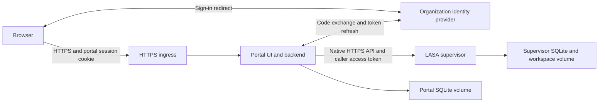

# Optional LASA caller portal

**Status** Proposed

The portal gives a human caller one place to submit work, follow its progress, answer clarifications, and retrieve released results. **New task** opens a general request backed by `task.attempt`. The first named form, `design.review`, fits the same task lifecycle and can follow the general-task pilot. Operators enable the portal by deploying a separate `lasa-portal` image that contains both the UI and its backend. Each native API call uses the signed-in caller's LASA access token. [Architecture](architecture.md) · [Capability contracts](capabilities.md)

The initial deployment serves an internal audience, uses organizational single sign-on, and targets one configured JWT-enabled LASA receiver. The pilot offer accepts supplied text and is provisioned for local, pure execution with bounded budgets. LASA policy and bindings enforce the execution restriction. The portal verifies that the advertised offer has an empty allowed-effects list and uses the selected processing guarantee. [Task attempt contract](examples/capability-attempt.json) · [Receiver configuration](../CONFIGURATION.md)

## Components and ownership

| Component | Responsibility |
| --- | --- |
| Portal UI | Input forms, exact offer confirmation, submission recovery, task history, clarification, cancellation, and result presentation. |
| Portal backend | Browser sessions, sign-in, CSRF protection, bounded native API calls, input mapping, and a small submission recovery record. Serve HTML, static assets, and the browser API from one origin. |
| Identity provider | Authenticate people, assign access to the portal client, and issue compatible per-user LASA access tokens. |
| LASA supervisor | Caller-scoped discovery, admission, processing policy, task state, retention, verification, receipts, and artifact release. Authorize each request using the native caller identity. |

Implement the portal as a separate FastAPI app with server-rendered pages and a small same-origin JavaScript client for form interactions and polling. Package it under `v0/portal/` with its own image target and boot configuration. Use the packaged native wire schemas and the existing canonicalization routines to validate native API data. Communicate with the supervisor over HTTPS. The proposed OpenAI-compatible interface serves SDK clients and has its own release path. [Native OpenAPI](api.openapi.json) · [Proposed Responses interface](openai-interface.md)

## Caller experience

Use Codex as the interaction reference for task navigation and progress, and ChatGPT for the composer. Give the portal LASA's own typography, colors, and controls. The task is the durable unit of work. **New task** starts a new objective, and **Submit answer** continues the current task at its clarification checkpoint.

### Task sidebar

Use a shared shell with the task sidebar on the left and one main content area for the composer, history, or task detail. Put **New task** first, then recent conversations and a **My tasks** link to the full paged history. Use one native conversation title in the sidebar, header, and history. Show active and exceptional states in the sidebar, and include exact submission times in history and progress. Mark the selected row and give **Needs your input** a visible text label. Show unresolved submissions with their recovery links. Task links remain valid across sessions and devices while LASA retains the task.

On small screens, place the same sidebar in a drawer and keep the main content full width. Support keyboard navigation and return focus to the drawer trigger when it closes. Use the same status labels in the sidebar and task detail, with text carrying the state independently of color.

### New task composer

Open **New task** to a centered composer with a prominent multiline objective field. Put the first acceptance check directly below it and offer **Add a requirement** for additional checks. Reveal the optional context field through **Add context**. Place the processing guarantee and **Submit task** together at the bottom. Show a single eligible guarantee as a fixed setting. When several offers are eligible, display a picker and require the caller to select one before submission.

| Field | Native mapping |
| --- | --- |
| What do you want done? | `input.objective`. |
| What would count as done? | One or more required checks. Map each row's text to the description and sole acceptance criterion of one requirement. Assign its ID from its row position in the prepared submission. |
| What should LASA use? | Optional pasted context in `input.context`. Omit an empty field. |
| Processing | Show the selected offer's `processing` terms. For `provider_domain_only`, show the declared domain. For `approved_processing`, explain that processing may use approved providers under applicable policy. |
| Run without delegation | Put the checkbox under **Options** on **New task** and in the follow-up composer. Pass the choice on each send. Remember the latest task's choice from LASA's conversation response and let the caller override it before sending. Show the restriction under **Request details** on tasks that used it. |

For example, a caller can request “Turn these meeting notes into an action list” and require that every action carry the recorded owner or say “Owner unspecified.” The pasted notes are context. Show the effective input limit and place validation errors beside the relevant field. Enter inserts a newline in text fields. Submission uses the **Submit task** control and navigates to the task after durable receipt. If receipt is uncertain, open the recovery view for the original submission. LASA applies the final input accounting, budget, and deadline. In the pilot, leave `requested_limits` unset so the receiver applies the offer's limits. Create a native session for each new conversation. [Task request example](examples/task-request.json) · [Submission and authority](execution.md#submission-and-authority)

The capability catalog is caller-scoped. Show a start form only when the caller has an eligible offer for a supported exact contract digest. Resolve each supported digest through its own form and result renderer. The general form submits `task.attempt`. Expose `design.review` as a named action when its form ships and the caller has an eligible exact offer. The history view can display metadata for every owned task, including CLI submissions. For a released result with no specialized renderer, show a bounded, escaped JSON representation with the receipt and its released artifact links.

### Task detail and progress

Use the first task's stable `/tasks/{task_id}` URL. Show caller requests and replies on the right and LASA's questions and results on the left. Keep speaker labels available to assistive technology. Mark actionable questions with **LASA asks**. Show **Request details** when the caller supplied checks, context, or structured material. Preserve acceptance conditions alongside their descriptions when the text differs.

Keep the width of request bubbles with details stable as the disclosure opens and closes. Above a released answer or deliverable, show one quiet chevron control labeled **Worked for** with the elapsed time. Use **Result details** when timing is unavailable. The control reveals the formal outcome, check evidence, and ordered native consumer events for that result's task below the answer and its downloads. Identify synthesized checks as defaults there, and put the raw receipt and protocol verification identifiers inside **Technical receipt**. For a design review, show findings and recommendations directly and fold criterion coverage into the result details. For other structured results, include escaped result data in the same disclosure.

Use a one-row task header with the mobile drawer trigger and conversation title. In the composer dock, label the live disclosure **Activity** and include the active state and elapsed time while LASA works. Its panel shows ordered native consumer events. Keep cancellation directly available in the dock while it can still apply, including during clarification. Place recoverable errors and status checks beside the conversation so they do not change the fixed header height.

Anchor a compact composer below the conversation from the first render. After LASA records a follow-up, clear the sent draft and refresh the conversation in place. Enable Send once the caller can follow up on a released result, and leave the dock visible with an explanation if the task ends without that option. Show a dedicated **Reply to LASA** composer for an actionable clarification and retain the follow-up draft and optional fields in the open workspace while the caller replies. Begin with one draft line and grow up to five lines, then scroll inside the field. Keep the send control alongside the draft. **Options** opens an anchored desktop popover or a mobile sheet for acceptance checks, context, and processing terms. Keep the draft and option values on dismissal and return focus to the trigger. The portal supplies a default check to address a follow-up when the caller leaves checks blank. LASA includes the preceding released output as context and keeps the same processing terms.

Show a live elapsed timer while LASA is working and **Worked for** with each released result. Use the native work clock. It includes intake evaluation, execution, and verification, and pauses while LASA waits for the caller. Older tasks can show a duration when the retained state establishes it.

Open at the latest turn. Follow incoming turns while the caller is reading at the bottom, and preserve their scroll position when they move away. **Jump to latest** returns them to the bottom with keyboard focus in the conversation. On mobile, fit the workspace and options sheet to the visible viewport while the keyboard is open. Keep the send button visible in the composer and the **Done** button visible in the sheet while its fields scroll.

| Native state | Portal behavior |
| --- | --- |
| `evaluating` | Show **Checking request**. A `202` means LASA recorded it for evaluation. |
| `accepted`, `executing` | Show **Accepted** or **Running**. Poll the task detail. |
| `awaiting_input` | Show **Needs your input** and present the clarification composer at the bottom. |
| `cancelling`, `cancelled` | Show **Cancellation requested** until LASA confirms **Cancelled**. |
| `completed` | For a fulfilled `task.attempt`, lead with the answer. For an unable result, show **Unable to fulfill**, the reason, and the first unmet check in the caller's wording. Fold additional checks and evidence into **Worked for** or **Result details**. |
| `rejected`, `failed` | Show the safe caller-facing reason and the applicable next action. |
| `indeterminate` | Show **Outcome unconfirmed** and preserve the task link. Offer a fresh status check. LASA owns reconciliation. |

Read the current task for state, question, and released result. Read consumer events when the caller opens live activity or a result's progress disclosure. Refresh the live progress list while it is open as the revision advances. Page by the last displayed event's `sequence` as the exclusive `after_sequence`. Use bounded pages and display event order using the public status labels. Start task polling at two seconds, back off to ten seconds, and honor a bounded `Retry-After`. Pause polling while the page is hidden, refresh on focus, and stop automatic polling at a terminal state. Announce meaningful state changes to assistive technology while preserving focus. When content is denied, use the native control view for authorized status metadata and show that the result or question is unavailable. [Consumer task and event routes](api.openapi.json) · [Durable lifecycle and failures](execution.md#durable-lifecycle-and-failures)

### Clarification

Show the expiry beside the current released question and use the compact composer for **Reply**. Validate the field against the question's answer schema. Send the answer for the displayed question ID and revision with the current task `ETag` as `If-Match`. Keep the reply on the same task URL. After LASA records the answer, show **Answer received** while refreshing the task. If the question has changed or expired, load the latest task state and let the caller review any draft before sending it. Apply the same receipt recovery and revision checks as other task actions. [Clarification API](api.openapi.json) · [Mutation recovery](#persistence-and-retries)

## Identity and browser security

1. Register the portal backend as a confidential OpenID Connect client with one exact callback URL. Initiate Authorization Code flow with PKCE `S256`. Bind a random `state`, `nonce`, and verifier to a short-lived, single-use server transaction and a browser cookie. Use a top-level GET callback and a separate short-lived `SameSite=Lax` transaction cookie for that redirect. Accept only relative, allowlisted return routes.
2. Validate callback state, then exchange the code server-side. Validate the ID token signature, issuer, audience, expiry, and nonce with the configured issuer. Require assignment to the portal client. Register a portal client ID distinct from the LASA resource audience. Request that resource audience through the identity provider's supported mechanism. Forward the issued access token to LASA and use the ID token to establish the portal login.
3. Before enabling a deployment, qualify issued access tokens against the actual receiver. Its JWT profile requires a supported signing key and algorithm, the configured `iss`, a single string `aud` equal to `service.id`, and the `sub`, `exp`, `iat`, and `jti` claims. Provision each stable subject as a LASA `user` with exact capability grants. Bind the qualified identity-provider login subject to the expected LASA token subject. Use the proposed user-only task list to confirm the caller's receiver access before establishing the browser session.
4. Set an opaque `__Host-lasa_portal` session cookie with `Secure`, `HttpOnly`, `SameSite=Strict`, and `Path=/`. Rotate the session ID at sign-in, then navigate to the destination from a same-origin completion page. Require an exact `Origin` match and a session-bound CSRF token on authenticated mutations, including logout. Keep tokens server-side. Refresh under a per-session lock, replace rotated refresh tokens atomically, and require sign-in when refresh fails or the session expires. Logout invalidates the portal session, clears the cookie, and revokes the refresh token if the issuer supports revocation. LASA tasks remain accessible to the same provisioned caller after sign-in.

Use a maintained OIDC library and the issuer's qualified endpoints. Verify issuer key rotation against both the portal and LASA. LASA currently loads its configured JWKS at startup, so the receiver rollout needs a key-overlap and restart procedure unless its key-loading design changes. The local token issuance job documented in the current deployment provisions LASA tokens. The portal requires an interactive issuer that can issue compatible user access tokens. If the existing issuer cannot do that, qualify a separate JWT pilot receiver and issuer before enrolling users. [Receiver JWT implementation](../lasa_service/auth.py) · [Managed deployment](../deployment/DEPLOYMENT.md) · [OpenID Connect Core](https://openid.net/specs/openid-connect-core-1_0.html) · [OAuth browser application guidance](https://www.rfc-editor.org/rfc/rfc10017.html#section-6.1)

Apply `Cache-Control: no-store` to authenticated HTML, API responses, callbacks, and downloads. Serve fingerprinted assets locally with a restrictive Content Security Policy and use a no-referrer policy on authenticated pages. Escape all task content, including result text, criterion evidence, problem details, and filenames. Serve artifacts as downloads with `Content-Disposition: attachment`, safe generated names, `X-Content-Type-Options: nosniff`, and the validated native digest. Have LASA reauthorize the artifact on each download. Route users to sign-in after credential expiry and keep the current task or submission recovery link.

## HTTP interfaces

Use a fixed portal route set. Browser-facing errors carry a stable code, a safe message, an optional field path, and a portal request ID. Translate native requests and errors explicitly. Reject unexpected fields and media types. Keep the browser on the portal origin and construct each downstream URL from typed resource IDs and the configured LASA prefix.

| Portal route | Action |
| --- | --- |
| `GET /auth/login`, `GET /auth/callback`, `POST /auth/logout` | Browser authentication and local session teardown. |
| `GET /`, `GET /new`, `GET /tasks`, `GET /tasks/{task_id}`, `GET /submissions/{submission_id}` | Open the new-task composer from the home route and render composer, history, task, and recovery pages in the shared shell. |
| `GET /api/offers` | Enumerate the caller's native catalog and return eligible offers for supported forms. |
| `GET /api/submission-ticket` | Issue a short-lived, caller-bound ticket for a new send attempt. The composer retains that ticket for an unresolved retry. |
| `POST /api/submissions` | Validate a ticket, exact selection, and form input. Start or recover one native task. Return `202` with a task link after durable native receipt. Return `503 submission_unconfirmed` with a recovery link for an ambiguous native exchange. |
| `GET /api/submissions/{submission_id}` | Resolve a known portal submission through the original native operation IDs. Return `checking`, `recorded`, `rejected`, or `unconfirmed` and any authorized task link. |
| `GET /api/tasks` | Page the native caller-owned task list and include unresolved portal submission links on the first page. |
| `GET /api/tasks/{task_id}` | Fetch the current native task and forward its strong `ETag`. Support `?view=control` for status metadata. |
| `GET /api/tasks/{task_id}/conversation` | Read one native conversation page using the caller's token. |
| `POST /api/tasks/{task_id}/follow-ups` | Submit a follow-up to the latest released result and use the submission journal to recover an uncertain receipt. Return the original conversation URL. |
| `GET /api/tasks/{task_id}/events` | Page native consumer status events in sequence order for the progress list. |
| `POST /api/tasks/{task_id}/inputs`, `POST /api/tasks/{task_id}/cancel` | Send the native mutation with a stable operation ID, `Idempotency-Key`, and the task `If-Match` value. |
| `GET /api/tasks/{task_id}/artifacts/{artifact_id}` | Read released bytes using the same caller credential and return an authenticated download. |

The backend checks the authenticated native descriptor for the configured service identity, base URL, JWT issuer and audience, protocol version, wire schema digest, and supported required features. Check that the native OpenAPI document advertises the task list and the other required operations. Use the same receiver prefix for all calls and disable upstream redirects. Scope any descriptor or discovery cache by caller and receiver. Honor discovery ETags and expiry. Stop bounded enumeration on inconsistent catalog revisions and refresh the catalog. [Discovery protocol](discovery.md) · [Native OpenAPI](api.openapi.json)

### Native task history addition

Add `GET /tasks?limit=25&cursor=…` relative to the native API base URL. Require a LASA `user` principal. Apply the same caller ownership and public status projection as the task control read. Join tasks through their owning sessions and query the authenticated owner on every page. Return `200` with these two fields.

| Member | Type and meaning |
| --- | --- |
| `tasks` | Array with at most `limit` entries. Each entry contains `task_id`, nullable `title`, the exact `contract` reference, `received_at`, and public `status`. |
| `next_cursor` | Opaque string scoped to the owner and receiver, or `null` at the end. |

Sort newest first by `(received_at, task_id)` and use keyset pagination. Default to 25 and allow 1–100. Authenticate cursor contents and reject tampered or foreign cursors with a safe `400`. Use indexed access to the owner and ordering keys and retain one canonical status projection. Return `Cache-Control: no-store`. This is a live list. New tasks appear after a first-page refresh and retired tasks disappear under native retention. The task detail and download routes apply current release checks when the caller opens content. [Native store](../lasa_service/store.py) · [Consumer projection](../lasa_service/consumer.py)

Define the list response in OpenAPI using references to the existing task property schemas where applicable. Keep the shared `contracts.schema.json` digest and descriptor feature vocabulary stable so peers that pin the wire schema digest can continue to negotiate. Detect the list operation from authenticated OpenAPI. Qualify existing peer discovery and submission with the extended OpenAPI document. [Peer negotiation](../lasa_service/peer.py) · [Current API handlers](../lasa_service/api.py)

### Native task conversation

Require the owning LASA user and current read authority on `GET /tasks/{task_id}/conversation`. Return an ascending page of `{sequence, task_id, kind, content}` turns, the first task's `task_id`, nullable `title`, `latest_task_id`, `latest_delegation`, nullable `follow_up_processing`, and a nullable `next_after` cursor. Include the saved `delegation` on request turns, the latest task's nullable `work_clock`, and each result turn's frozen `work_ms` outside the released result and receipt. All linked task IDs resolve to the same conversation. Sequence numbers increase across tasks. Use `after_sequence` as an exclusive cursor and default `limit` to 8 with a range of 1–32. Return `Cache-Control: no-store`. This is a live read and another turn can appear after the caller reaches the latest page.

Derive the title once from the first objective or the first explicit design review criterion. Normalize the first line and limit the title to 64 characters. Preserve it across follow-ups. Create titles lazily for retained requests. Both listing and conversation reads check current authority and caller-response disclosure for the title and its source. A restricted or unavailable title is null, which the portal displays as **Untitled conversation**. A title is conversational metadata outside the shared contract digest and signed result receipt.

Project the typed original input from the native task request. Store a question when LASA commits its awaiting-input checkpoint and a reply when LASA commits its input receipt. An idempotent replay returns the existing receipt. Use the native caller-response policy for original input and replies, the recorded release for questions, and the canonical result and receipt for the final turn. If a page contains content that fails a current check, deny the page. Artifacts remain separate authorized downloads. Native task retention covers the conversation, and the portal fetches it on demand. Earlier tasks can show their retained input and result. LASA began retaining settled clarifications with this endpoint. [Native OpenAPI](api.openapi.json) · [Content security](content-security.md)

Send `POST /tasks/{task_id}/follow-ups` on the current last task with `Idempotency-Key` and a typed `TaskRequest`. LASA checks the ownership, current release grant, idle session, retention window, and pure `task.attempt` offer. A follow-up uses the same contract and processing terms with its own admission, deadline, budget, and verification. LASA adds the previous released output to the effective input, carries forward its content classification, and applies fresh input and processing checks. Follow-ups accept typed task input and optional caller text context. The carried output counts toward native input limits. The operation receipt binds the submitted body, and the consumer task and result bind the effective request. A new task, its operation receipt, and its link commit together. Each predecessor admits one follow-up. The task list shows one row per conversation with the latest task's status. [Native OpenAPI](api.openapi.json)

## Submission and recovery

### Exact selection and durable receipt

1. The caller confirms an offer. Keep its contract ID, version, and digest together with `offer_id`, `offer_revision`, and `catalog_view`. Refresh that offer and its availability before the first submission. Require fresh confirmation for a changed selection or expired offer, including when the new revision only renews a lease. Availability is advisory. Use LASA's native admission result as the authority.
2. Validate the typed input against the pinned contract, assign requirement IDs deterministically within the submission, and enforce the encoded request and native input limits. Create a recovery record before sending a mutation. Allocate distinct stable operation IDs and idempotency keys for session creation and task submission.
3. Send `POST /sessions` with its operation ID. Persist the returned session ID and admission cutoff. If using the operation receipt to recover the session ID, fetch `GET /sessions/{session_id}` for the cutoff. Send `POST /sessions/{session_id}/tasks` with the original selection and typed input. Save the task ID returned by `202` or from the task operation receipt. Navigate to the task detail page.
4. On a fresh `offer_changed` or `catalog_changed` with a known pre-commit rejection, refresh the catalog and request confirmation before a new submission. A transport failure after a possible send enters recovery against the original operation. Prevent repeat clicks in the UI and use the submission record to coalesce concurrent requests. [Native request and receipt semantics](execution.md#durable-lifecycle-and-failures)

### Persistence and retries

The server issues a signed submission ticket containing a random submission ID, owner binding, receiver, and expiry. The browser sends the same ticket when retrying the same submit action. Store the recovery record keyed by `(receiver, issuer, subject, submission_id)`. It holds the pinned selection, each phase's operation ID, idempotency key and HMAC of the canonical native request digest, session and task links when known, the current phase, and expiry. Keep task objectives, context, answers, and released results out of the portal store. The edit form retains its draft in page memory while open.

Commit each phase before a possible outbound mutation. Give each phase one bounded in-flight caller, and leave interrupted attempts eligible for receipt lookup after the claim expires. On timeout, disconnect, or restart, look up the original `GET /operations/{operation_id}` and validate its resource type, operation ID, and matching request digest. A session receipt recovers the session ID. A task receipt recovers the task ID and exact selection. If the payload is still available and matches after canonicalization, repeat the same native request and key only until the earliest of the ticket expiry, the documented native retry cutoff, and the session's admission cutoff when known. A fresh request with changed form data needs a fresh ticket. A ticket tied to an unresolved operation stays tied to that operation.

A missing receipt leaves the submission **Unconfirmed**. Use bounded, read-only receipt checks and let the caller return later. When a user has closed the form and the payload is gone, the portal can still recover a late receipt and link the task. If the retry window closes, keep the old submission available for read-only recovery while its receipt can still exist. Expired tickets reject new writes even after journal cleanup. Recoverable entries have a configurable ceiling per caller and globally. Set journal retention to cover the receiver's configured receipt window. Stop storing the pending record after that window and keep native task links available through native history for as long as LASA retains the task.

If a response body is lost during clarification or cancellation, check the action's operation receipt and refresh the task before accepting further input. Answer mutations carry `question_id`, `question_revision`, and the current task `If-Match`. Cancellation carries its own operation ID and `If-Match`. On `412`, reload the current state and require the caller to review the new question or task state before submitting a new action. If completion wins a cancellation race, display the completed disposition. Preserve safe problem codes for known failures and treat indeterminate disposition as a status check path. [Task mutations](api.openapi.json) · [Native operation lookup](../lasa_service/api.py)

## Packaging and deployment

Build one `lasa-portal` image that packages the Python app, templates, and static assets. Install locked dependencies in a build stage and put the installed app and assets in the runtime stage. Run one ASGI process as a non-root user with a read-only root filesystem. Mount its configuration and secrets read-only and give it one writable portal-state volume. Use the existing HTTPS ingress infrastructure to route a dedicated configured hostname to the portal. Set an exact public origin and trust forwarded headers only from that ingress. Give the portal network access to its configured LASA receiver and identity provider endpoints. [Managed LASA deployment](../deployment/DEPLOYMENT.md) · [Docker multi-stage builds](https://docs.docker.com/build/building/multi-stage/)

| Runtime setting | Required behavior |
| --- | --- |
| Public origin and receiver | Exact portal HTTPS origin, LASA HTTPS base URL including prefix, expected service ID, and optional private CA bundle. |
| Identity provider | Fixed issuer, registered client ID, allowed audience mechanism, and a mounted secret for `client_secret_basic`. |
| Portal state | Dedicated persistent volume and runtime-mounted keys. Hash opaque cookie IDs at rest. Encrypt token material and protect recovery record integrity. Expose expiry and cleanup settings. |
| Time and size limits | Configure bounded request and upstream timeouts, request bytes, per-user and global concurrency, polling rates, session lifetime, ticket lifetime, and journal limits. Proposed starting values are 128 KiB for incoming JSON, five minutes for login transactions, 30 minutes for ticket and session idle time, and eight hours for maximum session lifetime. The effective input limit also respects the contract and the selected offer. |
| Processing and logging | Qualify the ingress, portal runtime, state volume and backups, monitoring, and support access for the offers exposed. Disable task content, tokens, cookies, callback query strings, and raw request bodies in routine logs. |

For `provider_domain_only`, qualify the portal as part of the approved task ingress and release path before showing the offer. For any offer, use LASA's existing intake inspection, result release, and artifact integrity checks. The portal handles content at the browser trust boundary and avoids external scripts, content analytics, and crash-report payload capture on authenticated pages. [Processing boundaries](multi-peer-delegation.md) · [Content inspection](content-security.md)

Expose a minimal liveness endpoint and a readiness check for configuration and an available portal store. Check end-to-end issuer and LASA compatibility with an authenticated canary. Log metadata-only request counts and latencies for sign-in, native receipt, status polling, download, cancellation, and ambiguous delivery. Correlate a portal request ID with authorized native operation or task IDs. Rate-limit expensive writes and history/polling independently. A portal restart or withdrawal leaves accepted work in LASA. Pause new submissions during rollback when necessary and leave reads available while the portal drains active HTTP requests.

## Persistent storage

The pilot uses two independent SQLite databases on separate persistent, host-local volumes. One portal instance owns the portal volume. Each LASA supervisor owns its existing state volume. The portal reaches supervisor data through the authenticated native API.

| Owner | Durable state |
| --- | --- |
| Caller portal | Browser sessions, encrypted token material, and the submission recovery journal. Each entry expires under the portal's retention policy. |
| LASA supervisor | `tasks.sqlite3` stores native sessions, tasks, operation receipts, artifacts, and execution and reconciliation records. The supervisor's state volume also holds the associated workspaces. The store uses an exclusive ownership lock and SQLite WAL. |

Take SQLite-consistent backups for each service. Retain the portal keys needed to decrypt tokens and verify journal records through the backup's lifetime. After restoring an older portal backup, invalidate pre-restore submission tickets and use native receipts to reconcile recoverable journal entries. Capture the supervisor database and workspaces together at a quiesced point. In a restore drill, verify task, workspace, and receipt linkage and run supervisor recovery before opening admissions. [SQLite WAL](https://sqlite.org/wal.html) · [Supervisor store](../lasa_service/store.py) · [Managed LASA deployment](../deployment/DEPLOYMENT.md)

### When to adopt PostgreSQL

| Component | Adoption trigger and requirements |
| --- | --- |
| Caller portal | Move when portal replicas on multiple hosts need to share sessions and pending submissions, or when a recovery requirement calls for managed backup or cross-host failover. Preserve unique submission IDs, atomic claims, serialized token refresh, and expiry across replicas. |
| LASA supervisor | Move when measured SQLite write contention or commit latency still prevents meeting service targets after query and transaction tuning, when a recovery requirement calls for managed database recovery, or as part of a qualified cross-host failover design. Failover also requires explicit task ownership and fencing, workspace availability, and reconciliation of live jobs, clarification waiters, and launcher state. Preserve atomic admission, receipt, and budget updates. |

Adopt PostgreSQL independently for each service. If both move, provision a separate database and credentials for each. Share a PostgreSQL instance only when its outage and restore scope and processing boundary are acceptable for both services. [Supervisor lifecycle](../lasa_service/coordinator.py) · [PostgreSQL database management](https://www.postgresql.org/docs/current/managing-databases.html)

## Implementation and acceptance

| Milestone | Evidence required |
| --- | --- |
| Receiver and sign-in | Qualify one real issuer and JWT receiver, including claim shape and signing-key rollover. Sign in as two distinct user principals. Verify login state and nonce replay rejection, token expiry and refresh, logout, CSRF enforcement, and denial for unassigned identities and peer or operator principals. |
| History and native contract | Validate the new OpenAPI operation and page schema. Exercise empty and multi-page history, equal timestamps, cursor tampering, account isolation, and native session retention. Verify matching CLI tasks appear and unrelated tasks stay private. Run affected schema, peer negotiation, and consumer privacy checks. |
| Caller experience | Complete the composer and navigate the task sidebar by keyboard at desktop and mobile widths. Verify that new turns preserve the reading position and that **Jump to latest** follows the ongoing task. Check that focused composer fields and the send button remain above the mobile keyboard. Reopen a task on a second device and verify its current action and ordered progress. Distinguish **Fulfilled**, **Unable to fulfill**, and **Outcome unconfirmed** at a glance. |
| General task and release | Submit a task that fulfills the objective, one that needs clarification, and one that returns `unable`. Confirm processing terms and receipt identity. Verify input inspection, released result rendering, authenticated artifact retrieval, and denial after a relevant release or access revocation. Exercise cancellation and its race with completion. |
| Recovery | Exercise duplicate clicks, conflicting reuse, catalog changes, lost session and task acknowledgments before and after commit, late receipt arrival, expiry, and restart with the same volume. Verify a changed or stale clarification is rejected and that an unresolved operation keeps its original identity. |
| Storage and restore | Restart each service with its own persistent volume. Restore each backup in isolation and verify portal session and journal recovery, pre-restore ticket invalidation, and supervisor task, workspace, and receipt linkage. |
| Packaging and pilot | Build one immutable portal image and run the HTTPS flow with an isolated LASA receiver and synthetic content. Inspect container mounts, cache and logging behavior. Verify that omitting or withdrawing the portal leaves the native receiver usable. |

Finish the pilot with the general task flow and these checks. When adding `design.review`, qualify its exact digest, dedicated fields, and findings and coverage renderer through the existing portal lifecycle. [Design review contract](examples/capability-review.json)
