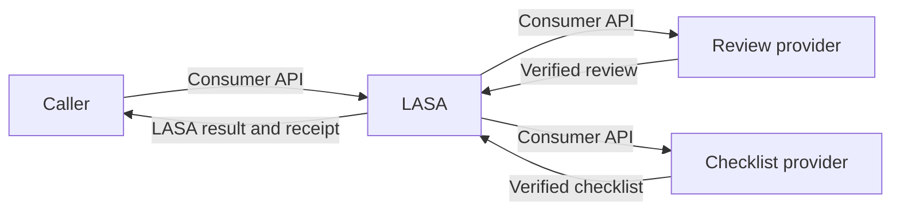

# Processing boundaries and recursive fulfillment

The caller consumes an offer from LASA. LASA may fulfill a requirement by consuming an offer from another provider, which may do the same under its own policy. Each provider authenticates its immediate consumer and owns admission, execution, verification, and release. One consumer API applies at every depth. The selected offer determines the processing boundary for the full task.

## Target offer contract

Add a required closed `processing` object to the target public offer schema. `provider_domain_only` requires a public, stable `domain` URI naming the provider's declared security domain. `approved_processing` carries only the mode and permits operator-approved processing consistent with agreement and source restrictions. Clients select an exact offer revision through the existing task request. The consumer can choose a boundary without receiving names of downstream providers, grants, topology, or route details.

```json
{"processing":{"mode":"provider_domain_only","domain":"urn:lasa:security-domain:main"}}
```

The offer term applies to all provider-side handling of task data, derived content, and task-bearing metadata. A domain-only offer permits composition inside the declared domain. Its normal authenticated release to the immediate consumer is a separately authorized transfer. An account agreement can require the domain-only guarantee and restrict offer visibility and admission accordingly. Discovery and single-offer reads expose the same processing commitment, while an accepted operation and its receipt bind the selected offer revision. A material change to the processing commitment creates a new offer revision. Renewal of a discovery lease preserves the existing terms.

## Target boundary enforcement

- Operators register domain membership and qualify its controls. Membership covers ingress, workers, inference and verification models, brokers, tools and connectors, inspection, caches, storage and backups, telemetry, and support access. Private network placement or sharing a host is insufficient. Enforce deny-by-default task-data egress in the restricted runtime and its adapters.
- Resolve the selected guarantee and intersect it with account and source restrictions before consuming the first content-bearing intake dependency, including DLP. Check both the intended recipient and the scanner receiving any projection. Pin the effective scope to the operation. Recheck current policy and revocations at use or dispatch, and preserve restrictions through clarification, restarts, fallbacks, caches, joins, and artifacts. Revocations can narrow the scope during execution.
- Publish a domain-only offer only after qualifying its full processing path. If a qualifying path becomes unavailable, surface a LASA-scoped `processing_unavailable` disposition before any prohibited transfer. Alternate executors, scanners, models, and recovery paths must satisfy the same scope.

## Target recursive execution

The receiver starts with a leaf policy for inbound peer offers. Operators grant onward fulfillment for an exact immediate consumer and offer, with eligible downstream offers, effects, data classes, disclosure terms, a minimum verification margin, and a per-task lifetime fan-out ceiling. Operators provision a separate subtree cap only when needed under the rule below. Cross-domain work in this profile is pure or read-only. A provider can advertise separate offers under different terms for the same outcome.

Before each child dispatch, establish that the downstream offer and provisioned relationship can enforce the applicable source and processing restrictions. Disclose only the exact necessary typed input and approved artifacts after a fresh inspection and release decision. A LASA-domain-only task requires every child to fulfill entirely within that same declared domain, including any work the child delegates. A task that permits external processing may select a child offer with a stricter guarantee, such as fulfillment wholly inside the child's declared domain. The receiver independently admits the task using its local grant. Upstream credentials, ancestry, execution plans, and delegated work allowances stay outside the consumer task request.

### Inherited deadlines and lifetime fan-out

1. Pin each task's absolute deadline at admission. Set each child's deadline through the ordinary supported task limit. The child deadline must be actionable at dispatch and at least the positive verification and release margin earlier than its parent's deadline. Budget for clock uncertainty and timestamp precision so the guaranteed margin survives both. Use a larger margin when the task needs more time to verify and release. The receiver may shorten its deadline. Retries, restarts, fallback and provider re-entry must preserve the applicable latest deadline and cannot revive expired work. Bound cancellation and reconciliation separately.
2. Each task enforces an operator-provisioned lifetime fan-out ceiling for distinct direct child operations. A leaf has a ceiling of zero. Atomically and durably reserve one unit before a submission could reach its receiver, including when siblings dispatch concurrently. A potentially delivered operation remains charged through rejection, cancellation, or an unknown disposition. Return a reservation only with durable evidence the submission could not have reached the receiver. An ambiguous retry reuses the original receiver, offer revision, operation identity, payload, deadline, and reservation. Bound transport retries separately.
3. Pin the exact offer revision and provisioned peer terms before dispatch. Authenticate a peer-only commitment to the relationship, offer, processing terms, applicable margin and fan-out guarantees, and any agreed private cap. Recheck the commitment before dispatch. The receiver independently applies the same rules to its children and enforces the guarantees across every eligible onward route. An incompatible or unqualified route is ineligible before task-data dispatch. A route change within the eligible envelope preserves reservations and the original task's effective deadline.

### Derive the bound before applying a subtree cap

At admission, use the effective remaining time `T`, a positive lower bound `M` on the guaranteed margin across all eligible onward edges, and an upper bound `B` on the lifetime fan-out of every eligible task. The immediate offer terms must substantiate these bounds through onward fulfillment. A conservative maximum depth is `D = floor(T / M)`. The worst-case descendant count is `B + B² + … + Bᴰ`. It is zero if `B` or `D` is zero, and equals `D` if `B` is one. The bound may include a final edge whose deadline would already be unusable. For a tighter bound, subtract the local margin from `T`, compute one plus the descendant bound under each eligible child's pinned terms, and multiply the largest branch by the local fan-out. A known leaf contributes one operation to its parent.

When the derived count is at or below the operator's accepted maximum, the deadline and direct-child ledger are sufficient. For example, `T = 90 seconds`, `M = 20 seconds`, and `B = 2` yield four levels and at most 30 descendants. An operator maximum of 30 permits this envelope with no separate cap. With a maximum of 24, narrow the eligible envelope to fit or enforce a private cap of at most 24. If neither is possible, do not dispatch recursively. If the provider cannot establish the margin and fan-out guarantees for all eligible onward work, the route is ineligible.

A capped task reserves one unit for each immediate child plus that child's full agreed descendant allowance, atomically with the direct-child reservation before dispatch. The receiver locally enforces at most the agreed allowance. The cap remains binding at every descendant even if a descendant would independently qualify for the default. A new credential, offer, or retry cannot reset the allocation. Apply the same conservative charging rule after potentially delivered submission. Keep numeric limits, allocation records, and commitment verification material in private state. There is no change to the consumer task contract.

Receivers enforce their own local resource and concurrency ceilings. Independent ready steps may dispatch concurrently after the applicable reservations. Dependent steps wait for verified inputs and a fresh disclosure decision. If an offer promises a maximum consumer charge, reserve the maximum charge for each direct child before dispatch. Guarantees in an independent domain depend on that provider's qualified enforcement. Local step dependencies stay acyclic, and a provider may forbid re-entry locally. Each edge uses only its immediate relationship and local ledger. Keep direct child linkage and raw evidence in operator-only records. Cancellation and reconciliation follow direct relationships. Report confirmed cancellation only with evidence, quarantine late outputs, and keep terminal results immutable.

## Current one-hop deployment

The Mac and air188 workflow below uses the current pure/read-only profile. Incoming service principals have locally fulfillable offers, zero onward budget, and no onward grants. LASA privately bounds its direct fan-out. The current runtime also requires a private subtree reservation for each delegated task. The two calls are siblings owned by LASA. The target design above treats this arrangement as a leaf configuration of recursive fulfillment with deadline-derived bounds.



The two downstream providers have no direct edge. For `design.review-checklist`, LASA verifies the review against the original review criteria before it can serve as typed input for the checklist. A private grant for the checklist receiver must permit disclosure of the predecessor's source resources. LASA makes a fresh inspection decision on the exact outbound request containing the handoff and rechecks that decision before task submission. The checklist provider verifies its own local outcome. LASA independently verifies the returned checklist against its requirements and the verified review, assembles the typed result, then runs the caller-facing release checks.

## Operator configuration

Operators configure each downstream descriptor's expected service ID, HTTPS origin and path prefix, TLS trust, and receiver-audience credential reference. A sender can use JWT with one provider and static bearer authentication with another. For a static-token service principal, the receiver requires the `LASA-Workload-Identity` header to match the authenticated principal and receiver. The recipient's configuration independently limits the service principal's available offers, data, and read permissions.

LASA grants each outbound edge by exact `(sender, receiver, contract)`. A grant includes effects, allowed resource actions, and resources eligible for disclosure. LASA also enforces current content-disclosure policy and configured inspection at each transfer. The consumer submits a selected offer revision, typed inputs and acceptance criteria, and supported execution limits. Provider-local policy grants, identities, downstream reservations, routing rules, and inspection profiles are provisioned separately.

## Selection and recovery

1. LASA derives the eligible routes from current outbound grants and exact contract requirements. It verifies the peer identity, wire schema digest, negotiated features and required paths before dispatch. An incompatible receiver cannot create a session or task.
2. The controller checks the exact current offer, resource/effect scope, availability, and budget. It can consider another eligible route before remote task submission. After a potentially delivered submission it stays with the original receiver.
3. LASA uses the same session, task, operation receipt, status, cancellation, and artifact endpoints on both edges. The remote operation is durable, keyed to LASA's receiver-local principal, and bound to the original request digest. Lost acknowledgements are reconciled against that receiver. The private ledger holds the reservation while disposition remains uncertain and conservatively charges the dispatched allocation once terminal.
4. LASA checks the authenticated provider's task, operation, selection and request linkage, its result receipt, the typed result, and artifact IDs, digests and total bytes. LASA then independently verifies the outcome. Its receipt binds the exact approved caller result to LASA's own operation. Child identifiers, peer evidence, and budgets remain in private records.

Consumer progress, clarification, errors, and results use purpose-specific schemas. Artifact release binds the actual bytes and public metadata. Private operator routes require a distinct principal. They report evidence from the local provider's own store. See [execution](execution.md) and [deployment verification](../VERIFICATION.md).
